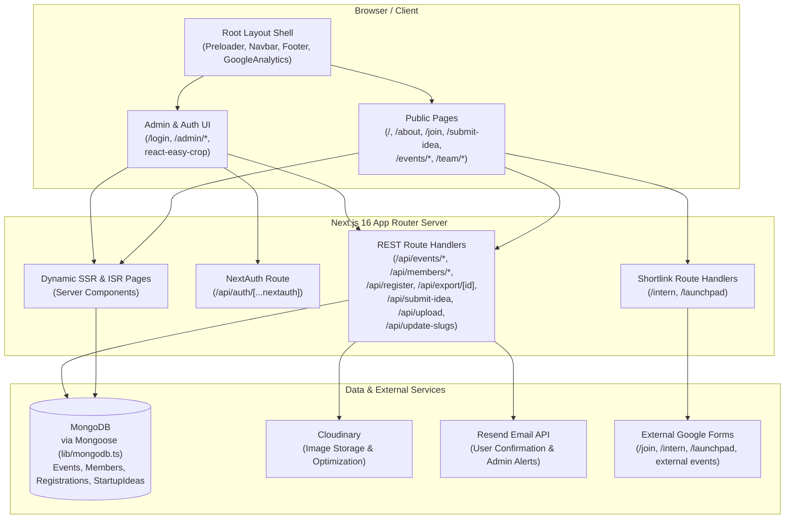
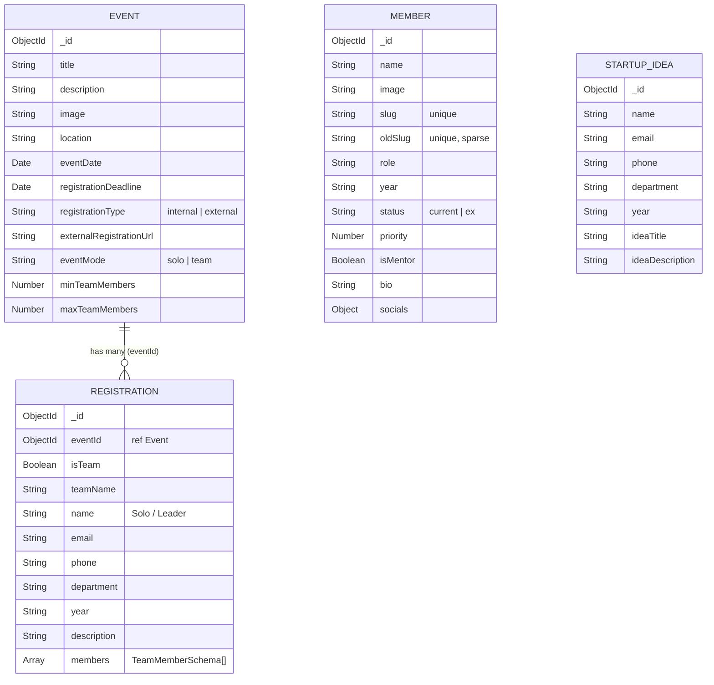
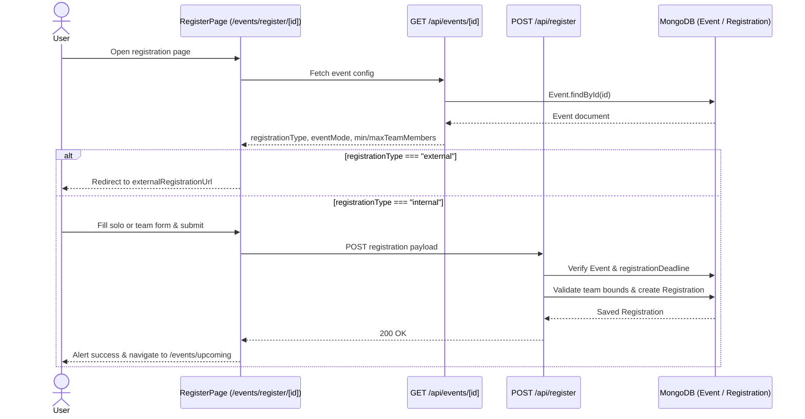
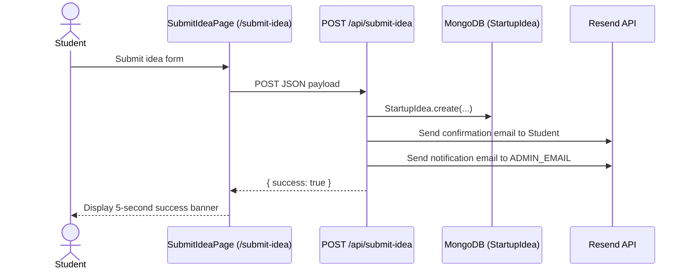
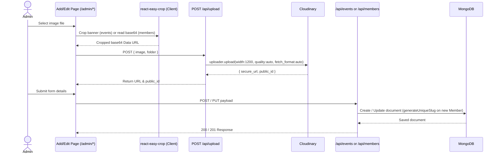
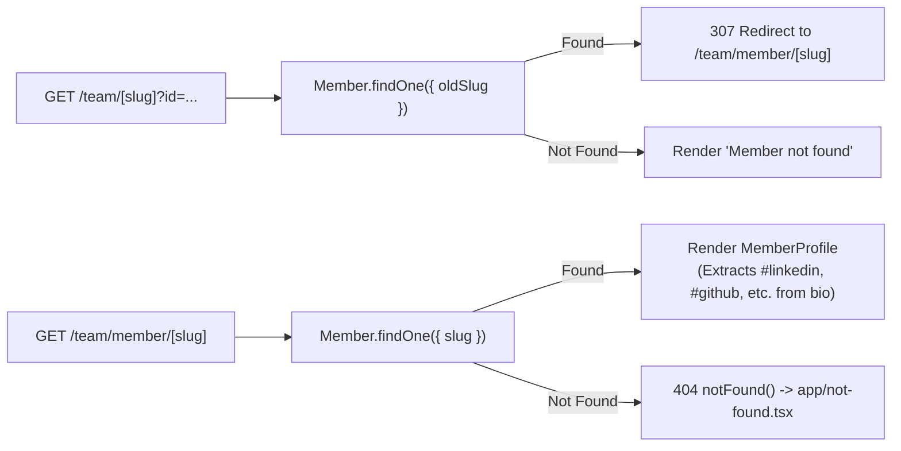

# Project Architecture — Legacy IEDC UCEK

> Official web platform for **Legacy IEDC UCEK** (Innovation and Entrepreneurship Development Centre, University College of Engineering, Kariavattom).
> Configured domain: `iedc.uck.ac.in` (`CNAME`)

---

## 1. Project Summary

The application is a full-stack Next.js (App Router) platform that serves two primary roles:

1. **Public Portal**: Showcases the organization's mission, vision, history ("The Saga"), current and alumni team directories with slug-based member profiles, upcoming and archived events, solo/team event registration, and startup idea submissions.
2. **Admin & Mentor Dashboard**: Provides an authenticated management interface for creating/editing/deleting events and team members, cropping and uploading media to Cloudinary, inspecting event registrations, and exporting registration rosters to CSV.

---

## 2. Tech Stack

| Layer | Technology | Version / Notes | Key Files |
| :--- | :--- | :--- | :--- |
| **Framework** | Next.js (App Router) | `16.1.6` | `package.json`, `app/layout.tsx` |
| **UI Runtime** | React & React DOM | `19.2.4` | `package.json` |
| **Language** | TypeScript | `^5` (`strict: true`) | `tsconfig.json` |
| **Styling** | Tailwind CSS, DaisyUI, `tailwindcss-animate` | `^3.4.1`, `^4.12.14`, `^1.0.7` | `tailwind.config.ts`, `app/globals.css` |
| **Animations & Icons** | Framer Motion, Lucide React, React Icons | `^12.34.2`, `^0.436.0`, `^5.3.0` | `app/page.tsx`, `components/MemberProfile.tsx` |
| **Database & ODM** | MongoDB & Mongoose | `^9.2.1` | `lib/mongodb.ts`, `models/*` |
| **Authentication** | NextAuth.js (`CredentialsProvider`, JWT) | `^4.24.13` | `app/api/auth/[...nextauth]/route.ts`, `app/types/next-auth.d.ts` |
| **Media Storage & Cropping** | Cloudinary & `react-easy-crop` | `^2.9.0`, `^6.0.2` | `lib/cloudinary.ts`, `app/api/upload/route.ts` |
| **Transactional Email** | Resend | `^6.9.2` | `app/api/submit-idea/route.ts` |
| **Analytics** | `@next/third-parties/google` (`GoogleAnalytics`) | `16.1.6` (`gaId: G-F5Y4P1CMWN`) | `app/layout.tsx` |

---

## 3. High-Level System Architecture

### Root Layout Shell (`app/layout.tsx`)
Every route renders inside `RootLayout`:
1. `Preloader` (`components/Preloader.tsx`) — plays `/preloader.mp4` full-screen for 2 seconds on route changes.
2. `Navbar` (`components/Navbar.tsx`) — fixed top gold navigation bar with desktop dropdowns (`Team`, `Events`) and mobile slide-over drawer.
3. `<main className="pt-24 flex-grow">` — active route content.
4. `Footer` (`components/Footer.tsx`) — branding, page links, campus address, and social links.
5. `GoogleAnalytics` — tracks page views.

---

## 4. Database Schema & Data Models (`models/`)

All models connect through `connectDB()` in `lib/mongodb.ts`, which caches the Mongoose connection in `global.mongooseCache` (`maxPoolSize: 10`, `serverSelectionTimeoutMS: 5000`, `socketTimeoutMS: 45000`, `family: 4`).

### `Event` (`models/Event.ts`)

| Field | Type | Required / Default | Constraints / Notes |
| :--- | :--- | :--- | :--- |
| `title` | `String` | Required | Event display title |
| `description` | `String` | Required | Event details |
| `image` | `String` | Required | Banner URL (typically Cloudinary) |
| `location` | `String` | Required | Venue or online platform |
| `eventDate` | `Date` | Required | Used to split upcoming vs. previous events |
| `registrationDeadline` | `Date` | Required | Enforced on UI and `POST /api/register` |
| `registrationType` | `String` | Default `"internal"` | Enum: `"internal"`, `"external"` |
| `externalRegistrationUrl` | `String` | Default `""` | Target URL when `registrationType === "external"` |
| `eventMode` | `String` | Default `"solo"` | Enum: `"solo"`, `"team"` |
| `minTeamMembers` | `Number` | Default `1`, min `1` | API enforces `>= 2` for team events |
| `maxTeamMembers` | `Number` | Default `1`, min `1` | `PUT` enforces `<= 10` for team events |
| `timestamps` | `Date` | Auto | `createdAt`, `updatedAt` |

### `Member` (`models/Member.ts`)

| Field | Type | Required / Default | Constraints / Notes |
| :--- | :--- | :--- | :--- |
| `name` | `String` | Required | Member full name |
| `image` | `String` | Required | Profile photo URL |
| `slug` | `String` | `unique: true` | Generated via `generateUniqueSlug(role, year)` |
| `oldSlug` | `String` | `unique: true`, `sparse: true` | Used for legacy `/team/[slug]` redirects |
| `role` | `String` | Required | Designation matched against `roleStructure` |
| `year` | `String` | Required | Tenure/year string (e.g. `"2025"` or `"2024-2025"`) |
| `status` | `String` | Default `"current"` | Enum: `"current"`, `"ex"` |
| `priority` | `Number` | Default `0` | Sort tie-breaker in `/team` (within role order) and `/team/ex` |
| `isMentor` | `Boolean` | Default `false` | Mentor flag on `Member` records |
| `bio` | `String` | Optional | Bio text; `#linkedin`, `#github`, etc. parsed in `MemberProfile` |
| `socials` | `Object` | Default `""` per key | Keys: `linkedin`, `github`, `instagram`, `facebook`, `whatsapp`, `x`, `website` |
| `timestamps` | `Date` | Auto | `createdAt`, `updatedAt` |

### `Registration` (`models/Registration.ts`)

| Field | Type | Required / Default | Notes |
| :--- | :--- | :--- | :--- |
| `eventId` | `ObjectId` | Required | References `Event` |
| `isTeam` | `Boolean` | Default `false` | `true` when `event.eventMode === "team"` |
| `teamName` | `String` | Default `""` | Required when `isTeam === true` |
| `name` | `String` | Required | Solo participant or Team Leader name |
| `email` | `String` | Required | Participant / Leader email |
| `phone` | `String` | Required | Participant / Leader phone |
| `department` | `String` | Required | Department code |
| `year` | `String` | Required | Academic year (`1`–`4`) |
| `description` | `String` | Default `""` | Optional notes |
| `members` | `[TeamMemberSchema]` | Default `[]` | Additional members (`name`, `department`, `year`, `_id: false`) |
| `timestamps` | `Date` | Auto | `createdAt`, `updatedAt` |

### `StartupIdea` (`models/StartupIdea.ts`)

| Field | Type | Notes |
| :--- | :--- | :--- |
| `name`, `email`, `phone`, `department`, `year` | `String` | Submitter contact & academic metadata |
| `ideaTitle`, `ideaDescription` | `String` | Pitch title and detailed description |
| `timestamps` | `Date` | `createdAt`, `updatedAt` |

---

## 5. Routing & Rendering Architecture (`app/`)

### Public Routes

| Route | File | Type / Caching | Purpose & Data Source |
| :--- | :--- | :--- | :--- |
| `/` | `app/page.tsx` | Client Component | Hero, photo grid, Vision/Mission, Saga, recent events carousel (`GET /api/events/latest`), idea CTA, `AboutSection` |
| `/about` | `app/about/page.tsx` | Static Server Component | Organization story, Without vs. With IEDC comparison, Create/Sustain/Thrive ideals |
| `/join` | `app/join/page.tsx` | Static Server Component | Community application link to Google Form and contact email |
| `/submit-idea` | `app/submit-idea/page.tsx` | Client Component | Startup idea submission form (`POST /api/submit-idea`) |
| `/opinion` | `app/opinion/page.tsx` | Static Server Component | Placeholder page ("Share Your Opinion") |
| `/events/upcoming` | `app/events/upcoming/page.tsx` | SSR (`force-dynamic`) | Queries `Event` where `eventDate >= now`; renders `UpcomingEventCard` with countdowns |
| `/events/previous` | `app/events/previous/page.tsx` | SSR (`force-dynamic`) | Queries `Event` where `eventDate < now`, grouped by year; renders `EventCard` |
| `/events/register/[id]` | `app/events/register/[id]/page.tsx` | Client Component | Fetches `GET /api/events/[id]`; redirects if external; submits solo/team form to `POST /api/register` |
| `/team` | `app/team/page.tsx` | SSR (`force-dynamic`) | Queries all members (`current` + `ex`); `TeamByYearClient` groups by year with year filter tabs |
| `/team/current` | `app/team/current/page.tsx` | SSR (`force-dynamic`) | Queries `status: "current"` members, groups via `roleStructure`, renders `TeamMemberCard` |
| `/team/ex` | `app/team/ex/page.tsx` | SSR (`force-dynamic`) | Queries `status: "ex"` members; `ExMembersClient` adds client-side year filter pills |
| `/team/member/[slug]` | `app/team/member/[slug]/page.tsx` | ISR (`revalidate = 3600`) | Queries member by `slug`, renders `MemberProfile` |
| `/team/[slug]` | `app/team/[slug]/page.tsx` | Dynamic Server Component | Matches `oldSlug` (supporting `?id=` suffix) and redirects to `/team/member/[slug]` |
| `/intern` | `app/intern/route.ts` | Route Handler (`GET`) | `307` redirect to Google Form |
| `/launchpad` | `app/launchpad/route.ts` | Route Handler (`GET`) | `307` redirect to Google Form |
| `/robots.txt` | `app/robots.ts` | Metadata Route | Allows `/` and points to sitemap |
| `/sitemap.xml` | `app/sitemap.ts` | Metadata Route | Lists `/`, `/events/upcoming`, `/events/previous`, `/team`, `/about` |
| `404` (Not Found) | `app/not-found.tsx` | Client Component | Custom branded 404 page for unmatched routes and `notFound()` calls |

### Auth & Admin Routes

| Route | File | Type / Protection | Purpose |
| :--- | :--- | :--- | :--- |
| `/login` | `app/login/page.tsx` | Client Component | NextAuth credentials sign-in form; redirects to `/admin` |
| `/admin` | `app/admin/page.tsx` | ISR (`revalidate = 5`), **Session-gated** | Checks `session.user.role` (`admin` or `mentor`); renders stats and `AdminDashboardClient` (Events & Members tabs with filters) |
| `/admin/add-event` | `app/admin/add-event/page.tsx` | Client Component | Event creation form with `react-easy-crop` banner cropper & Cloudinary upload |
| `/admin/edit/[id]` | `app/admin/edit/[id]/page.tsx` | Client Component | Loads `GET /api/events/[id]`, supports banner re-crop & `PUT /api/events/[id]` |
| `/admin/events/[id]` | `app/admin/events/[id]/page.tsx` | Dynamic Server Component | Displays event overview, registration metrics, solo/team rosters, and CSV export link |
| `/admin/add-member` | `app/admin/add-member/page.tsx` | Client Component | Member creation form with photo upload (`POST /api/upload` -> `POST /api/members`) |
| `/admin/edit-member/[id]` | `app/admin/edit-member/[id]/page.tsx` | Client Component | Loads `GET /api/members/[id]`, replaces photo & updates via `PUT /api/members/[id]` |

---

## 6. API Endpoints (`app/api/`)

| Method(s) | Endpoint | File | Auth Check | Responsibility |
| :--- | :--- | :--- | :--- | :--- |
| `GET`, `POST` | `/api/auth/[...nextauth]` | `app/api/auth/[...nextauth]/route.ts` | Public (Auth) | NextAuth Credentials login (`admin@legacy.com`, `mentor@legacy.com`) with JWT role claims |
| `POST` | `/api/events` | `app/api/events/route.ts` | None | Validates required fields, registration type, and team size (`>= 2`), creates `Event` |
| `GET` | `/api/events/latest` | `app/api/events/latest/route.ts` | None | Returns the 5 most recently created events (`createdAt: -1`) |
| `GET`, `PUT`, `DELETE` | `/api/events/[id]` | `app/api/events/[id]/route.ts` | None | Fetches, updates (`maxTeamMembers <= 10`), or deletes an event and cascades `Registration` deletion |
| `GET`, `POST` | `/api/members` | `app/api/members/route.ts` | None | Lists members (`createdAt: -1`) or creates a member with `generateUniqueSlug` |
| `GET`, `PUT`, `DELETE` | `/api/members/[id]` | `app/api/members/[id]/route.ts` | None | Fetches, updates, or deletes a member; destroys old Cloudinary asset if `imagePublicId` exists |
| `POST` | `/api/register` | `app/api/register/route.ts` | None | Validates `eventId`, deadline, and team member details; creates `Registration` |
| `GET` | `/api/export/[id]` | `app/api/export/[id]/route.ts` | **Session (`admin` / `mentor`)** | Exports solo or team registrations as a downloadable `.csv` file |
| `POST` | `/api/submit-idea` | `app/api/submit-idea/route.ts` | None | Saves `StartupIdea` and sends confirmation + admin notification emails via Resend |
| `POST` | `/api/upload` | `app/api/upload/route.ts` | None | Uploads base64 image to Cloudinary (`width: 1200`, `crop: "limit"`, `quality: "auto"`, `fetch_format: "auto"`) |
| `GET` | `/api/update-slugs` | `app/api/update-slugs/route.ts` | None | Regenerates `slug` for all `Member` documents sorted by `year`, `role` |

---

## 7. Components, Libraries & Scripts

### Shared Components (`components/`)

| Component | Rendering | Purpose |
| :--- | :--- | :--- |
| `Navbar` (`components/Navbar.tsx`) | Client | Fixed gold header with active-route highlighting, dropdown menus, and mobile overlay |
| `Footer` (`components/Footer.tsx`) | Server | Site links, UCEK address, and social links |
| `Preloader` (`components/Preloader.tsx`) | Client | 2-second `/preloader.mp4` splash on navigation |
| `AboutSection` (`components/AboutSection.tsx`) | Client | Homepage summary & key stats (`Established 2020`, `#1 IN TVM`, `200+ Members`, `50+ Event Hosted`) |
| `MemberProfile` (`components/MemberProfile.tsx`) | Client | Profile layout; extracts `#social` hashtag links from `member.bio` |
| `AdminDashboardClient` (`components/AdminDashboardClient.tsx`) | Client | Tab switcher (`events` / `members`), filter forms, and card grids |
| `DeleteEventButton` (`components/DeleteEventButton.tsx`) | Client | Confirms and sends `DELETE /api/events/[id]`, reloads page |
| `DeleteMemberButton` (`components/DeleteMemberButton.tsx`) | Client | Confirms and sends `DELETE /api/members/[id]`, calls `router.refresh()` |
| `SignOutButton` (`components/SignOutButton.tsx`) | Client | Calls NextAuth `signOut({ callbackUrl: "/" })` |

### Route-Specific Client Components (`app/`)

| Component | File | Purpose |
| :--- | :--- | :--- |
| `TeamByYearClient` | `app/team/TeamByYearClient.tsx` | Groups all IEDC members by year with year filter pills and `roleStructure` ordering |
| `TeamMemberCard` | `app/team/current/TeamMemberCard.tsx` | Animated member card linking to `/team/member/[slug]` |
| `ExMembersClient` | `app/team/ex/ExMembersClient.tsx` | Alumni directory with year filter pills and `roleStructure` grouping |
| `UpcomingEventCard` | `app/events/upcoming/UpcomingEventCard.tsx` | Event card with countdown badge and internal/external registration link |
| `EventCard` | `app/events/previous/EventCard.tsx` | Archived event card with expandable description |

### Libraries (`lib/`) & CLI Scripts (`scripts/`)

| File | Exports / Purpose |
| :--- | :--- |
| `lib/mongodb.ts` | `connectDB()` — cached Mongoose connection helper |
| `lib/cloudinary.ts` | Configured Cloudinary v2 instance |
| `lib/memberSlug.ts` | `generateUniqueSlug(role, year)` — `${year}${initials}` with collision suffix |
| `lib/roles.ts` | `ROLES` — flat list of designations |
| `lib/roleStructure.ts` | `roleStructure` — ordered section headings and role arrays for UI grouping |
| `scripts/updateSlugs.ts` | Standalone `ts-node` script (`npm run update-slugs`) to regenerate member slugs |
| `scripts/updateOldSlugs.ts` | Script mapping legacy slugs (`no`, `cto`, `ceo`, etc.) to `oldSlug` |

---

## 8. Key Data Flows

### Event Registration Flow

### Startup Idea Submission Flow

### Admin Media Upload & Event/Member CRUD Flow

### Member Slug Resolution & Legacy Redirect Flow

---

## 9. Environment Variables & Static Assets

### Environment Variables Referenced in Code

| Variable | Used In | Purpose |
| :--- | :--- | :--- |
| `MONGODB_URI` | `lib/mongodb.ts`, `scripts/updateSlugs.ts` | MongoDB connection string |
| `CLOUDINARY_CLOUD_NAME` | `lib/cloudinary.ts` | Cloudinary cloud identifier |
| `CLOUDINARY_API_KEY` | `lib/cloudinary.ts` | Cloudinary API key |
| `CLOUDINARY_API_SECRET` | `lib/cloudinary.ts` | Cloudinary API secret |
| `RESEND_API_KEY` | `app/api/submit-idea/route.ts` | Resend transactional email key |
| `ADMIN_EMAIL` | `app/api/submit-idea/route.ts` | Recipient for new startup idea notifications |
| `NEXTAUTH_SECRET` / `NEXTAUTH_URL` | NextAuth runtime | Standard NextAuth JWT signing & callback URL config |

### Static Assets (`public/`)

| Category | Files |
| :--- | :--- |
| **Branding & Icons** | `legacy.png`, `iedc.png`, `logoy.jpeg`, `vision.svg`, `mission.svg`, `mission.png`, `file.svg`, `globe.svg`, `next.svg`, `vercel.svg`, `window.svg` |
| **Media & Galleries** | `preloader.mp4`, `img1.jpg`–`img13.jpg` (hero mosaic), `saga1.jpg`–`saga3.jpg` (story section) |

---

## 10. Notable Implementation Observations

| Area | Observation | Affected Files |
| :--- | :--- | :--- |
| **Authentication & Authorization** | Credentials are hardcoded (`admin@legacy.com` / `mentor@legacy.com`). Only `/admin` and `/api/export/[id]` check `getServerSession`; `/admin/*` subpages and mutating API routes (`/api/events/*`, `/api/members/*`, `/api/upload`, `/api/update-slugs`) lack server-side session checks. | `app/api/auth/[...nextauth]/route.ts`, `app/admin/*`, `app/api/*` |
| **Duplicate Next Configs** | Both `next.config.ts` (Cloudinary `remotePatterns`) and `next.config.js` (`unoptimized: true`, deprecated `images.domains`) exist at the project root. | `next.config.ts`, `next.config.js` |
| **Lint Script Compatibility** | `npm run lint` invokes `next lint` (removed in Next.js 16), and `.eslintrc.json` uses legacy format with ESLint 10 (`eslint.config.*` expected). | `package.json`, `.eslintrc.json` |
| **Role String Casing Mismatch** | `ROLES` uses lowercase `"and"` / `"curator"`, while `roleStructure` and admin member forms use Title Case `"And"` / `"Curator"`, which affects exact role matching (`section.roles.includes(m.role)`). | `lib/roles.ts`, `lib/roleStructure.ts`, `app/admin/add-member/page.tsx`, `app/admin/edit-member/[id]/page.tsx` |
| **`imagePublicId` Schema Gap** | `imagePublicId` is read and passed by the edit-member page and `PUT`/`DELETE` member API for Cloudinary cleanup, but is not declared in `MemberSchema`. | `models/Member.ts`, `app/api/members/[id]/route.ts`, `app/admin/edit-member/[id]/page.tsx` |
| **Socials Storage Split** | `MemberSchema` defines a `socials` object, whereas `MemberProfile` parses `#linkedin`, `#github`, etc. directly from `member.bio`. | `models/Member.ts`, `components/MemberProfile.tsx` |
| **Department Option Label** | In the event registration form, `<option value="EEE">` displays the label `"Information Technology"`. | `app/events/register/[id]/page.tsx` |
| **SEO & CI/CD Config** | `robots.ts` and `sitemap.ts` point to `http://localhost:3000`. `.github/workflows/nextjs.yml` configures a static GitHub Pages (`./out`) deploy despite the app relying on dynamic SSR, Mongoose, and API routes. | `app/robots.ts`, `app/sitemap.ts`, `.github/workflows/nextjs.yml` |

---

## 11. Build Scripts & Team Role Hierarchy

### NPM Scripts (`package.json`)

| Script | Command | Purpose |
| :--- | :--- | :--- |
| `dev` | `next dev` | Starts local Next.js development server |
| `build` | `next build` | Compiles production build |
| `start` | `next start` | Runs production Next.js server |
| `lint` | `next lint` | Runs ESLint (`next/core-web-vitals`) |
| `update-slugs` | `ts-node scripts/updateSlugs.ts` | Regenerates slugs in MongoDB for all members |

### Team Role Hierarchy (`lib/roleStructure.ts`)

| Order | Section Heading | Roles Included |
| :--- | :--- | :--- |
| 1 | `Nodal Officer` | `Nodal Officer` |
| 2 | `Project Coordinator` | `Project Coordinator` |
| 3 | `Mentor` | `Mentor` |
| 4 | `Executive` | `Chief Executive Officer`, `Chief Executive Officer (Vision & Planning)`, `Chief Executive Officer (Operations & Execution)`, `Women Lead` |
| 5 | `Quality And Operation` | `Chief Quality And Operation Officer`, `Quality And Operation Officer` |
| 6 | `Technology` | `Chief Technology Officer`, `Technology Officer` |
| 7 | `Branding And Marketing` | `Chief Branding And Marketing Officer`, `Branding And Marketing Officer` |
| 8 | `Finance` | `Chief Finance Officer`, `Finance Officer` |
| 9 | `Women Innovation` | `Chief Women Innovation Officer`, `Women Innovation Officer` |
| 10 | `IPR And Research` | `Chief IPR And Research Officer`, `IPR And Research Officer` |
| 11 | `Community` | `Chief Community Officer`, `Community Officer` |
| 12 | `Creative And Innovation` | `Chief Creative And Innovation Officer`, `Creative And Innovation Officer` |
| 13 | `Executive Curators` | `Executive Curator` |
| 14 | `Members` | `Member` |

